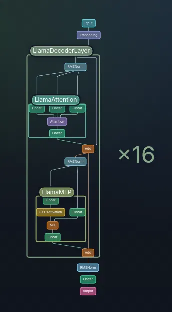

# decode-opt: W4A16 decode kernels on RTX 5070 Ti

> Llama-3.2-1B, batch 1–8 decode. Triton kernels (fused RMSNorm, fp16 GEMV, fused int4-dequant GEMV) → TPOT −X% vs. HF + CUDA Graphs.
> *(fill in the headline number on Day 18)*

## Results (TL;DR)
| setup | batch 1 TPOT (ms) | batch 8 TPOT (ms) | perplexity |
|---|---|---|---|
| HF fp16 + CUDA Graph | | | |
| + my W4A16 GEMV | | | |

## 0. Model: Llama-3.2-1B

hidden 2048 · intermediate 8192 · 16 layers · 32 query heads / 8 KV heads (GQA) · head_dim 64 · vocab 128,256 · lm_head tied to the embedding · RMSNorm eps 1e-5 (from the model's `config.json`).

<p align="center">
  
  <br>
  <sub>Architecture graph: <a href="https://hfviewer.com/meta-llama/Llama-3.2-1B">hfviewer</a> by Embedl</sub>
</p>

What this project replaces in one decode step (each sequence feeds 1 new token):

| module (per decoder layer) | shape (in → out) | replaced by |
| --- | --- | --- |
| RMSNorm × 2 (+ final RMSNorm) | 2048 → 2048 | fused RMSNorm kernel |
| q_proj / k_proj / v_proj | 2048 → 2048 / 512 / 512 | W4A16 GEMV |
| o_proj | 2048 → 2048 | W4A16 GEMV |
| gate_proj / up_proj | 2048 → 8192 | W4A16 GEMV |
| down_proj | 8192 → 2048 | W4A16 GEMV |
| attention (RoPE, KV cache), SiLU × up, residual add, lm_head | — | unchanged |

## 1. Where the time goes (why these kernels)

At batch 1–8, each decode step must read **every weight once** but does only ~B FLOPs per weight byte — far below the GPU's ridge point — so decode is **memory-bound** and time ≈ bytes moved / bandwidth. Bytes per decode step, from `python -m analysis.decode_breakdown --markdown` (peak 896 GB/s spec; replace with `results/peak_bw.json`):

| part | batch 1, ctx 512 (fp16) | batch 1, ctx 512 (W4A16) | batch 8, ctx 2048 (fp16) | batch 8, ctx 2048 (W4A16) |
| --- | ---: | ---: | ---: | ---: |
| MLP linears (gate, up, down) | 1,612 MB · 64.7% | 416 MB · 39.7% | 1,619 MB · 53.3% | 423 MB · 26.6% |
| attention linears (q, k, v, o) | 336 MB · 13.5% | 87 MB · 8.3% | 339 MB · 11.2% | 90 MB · 5.7% |
| lm_head (fp16, tied) | 526 MB · 21.1% | 526 MB · 50.2% | 527 MB · 17.4% | 527 MB · 33.2% |
| attention (KV cache) | 17 MB · 0.7% | 17 MB · 1.6% | 538 MB · 17.7% | 538 MB · 33.9% |
| RMSNorm + residual, SiLU×up, embedding | ~1.5 MB · 0.1% | ~1.5 MB · 0.1% | ~11 MB · 0.4% | ~11 MB · 0.7% |
| **total → TPOT lower bound** | **2,492 MB → 2.78 ms** | **1,047 MB → 1.17 ms** | **3,034 MB → 3.39 ms** | **1,589 MB → 1.77 ms** |

What this says:
- **Decoder linears are ~78% of the bytes at batch 1** → int4 weights (W4A16 GEMV, dequant fused) are the main lever: lower bound 2.78 → 1.17 ms (2.4×).
- After W4A16, **lm_head (still fp16) is the largest part** at batch 1, and **KV-cache reads** take over at long context × larger batch → next steps.
- **RMSNorm moves almost no bytes.** Its fused kernel matters for kernel-launch count and as the cleanest fusion example, not for bandwidth.

*Analytic estimate. Measured breakdown (nsys, `profiling/nsys_decode.sh`): TODO.*

## 1.1 Roofline
roofline: bytes per token vs. FLOPs per token, measured peak BW (`results/peak_bw.json`).

## 2. Kernels
### 2.1 Fused RMSNorm + residual
### 2.2 fp16 GEMV (v1 → v2)
### 2.3 W4A16 GEMV (v1 → v3) — main
format, layout, split-K, autotune, dispatch; %peak per layer; ncu findings.

## 3. End-to-end
TPOT before/after, nsys breakdown before/after, why kernel speedup ≠ TPOT speedup.

## 4. Limits & next steps
decode attention (split-K / FlashDecoding), Hopper/Blackwell datacenter features (wgmma, TMA, tcgen05), vLLM integration.

## Reproduce
```bash
# CUDA 12.8+, PyTorch built for cu128 (sm_120 support)
pip install -r requirements.txt
hf auth login                         # Llama-3.2-1B is gated

python -m bench.peak_bw               # measured 100% line
pytest -q                             # correctness (skips kernels not written yet)
python -m bench.run_all               # microbenchmarks -> results/bench_*.csv
python -m bench.plot                  # plots -> results/*.png
python -m e2e.measure_tpot --linear none
python -m e2e.measure_tpot --linear w4a16 --norm
python -m e2e.perplexity --linear w4a16_torch
bash profiling/nsys_decode.sh w4a16 --norm
```

## Layout
```
kernels/     Triton kernels (rmsnorm, gemv_fp16, gemv_w4a16)
quant/       W4A16 format: quantize, pack, dequant (source of truth)
reference/   PyTorch ground truth
specs/       model shapes + OpSpec registry (add a kernel version = one line)
analysis/    analytic bytes-per-decode-step breakdown (why these kernels)
bench/       harness, peak BW, run_all, plots
tests/       correctness on every real decode shape
e2e/         HF module patching, TPOT, perplexity
profiling/   nsys / ncu scripts
results/     CSVs and plots (committed)
NOTES.md     daily lab notebook
```